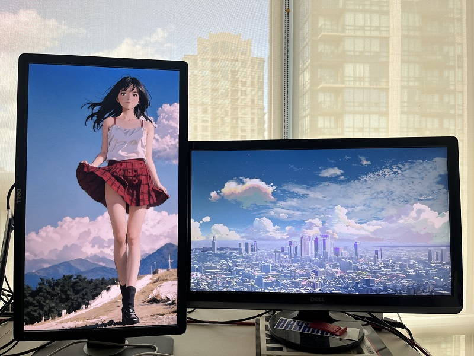
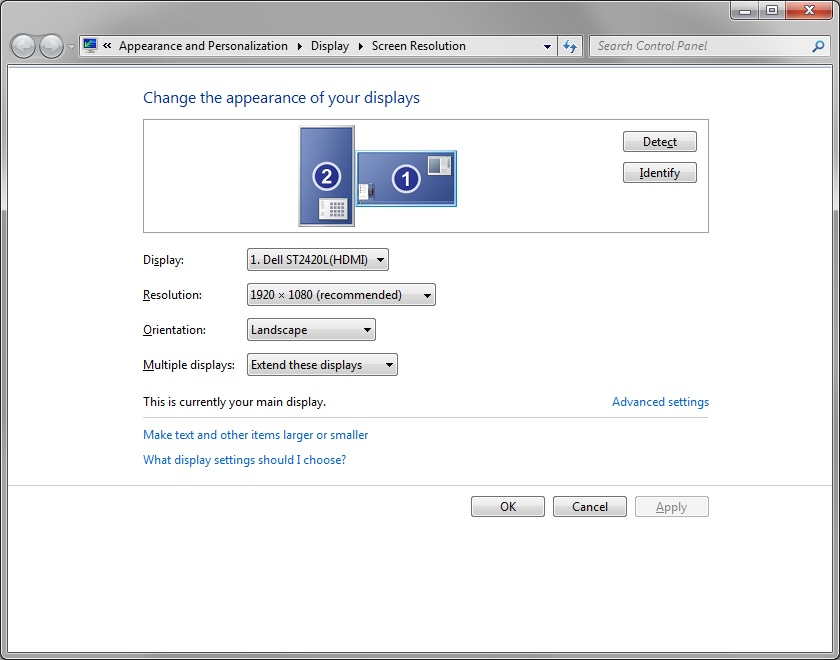

# Win7 下横屏 + 竖屏双显示器异形壁纸自动合成脚本

> 本文参考并借鉴了百度经验上的教程：[链接（简体中文）](https://jingyan.baidu.com/article/76a7e409e5d575fc3b6e15fc.html)  
> 原教程基于手动读取注册表并换算十六进制补码，存在诸多容易出错的地方；而且一旦更换显示器线材（例如 DVI 换 DP）或显卡接口，注册表中的 `UnitedVideo` GUID 路径就会发生变化导致脚本失效。本仓库的新版代码彻底抛弃了注册表硬编码，直接调用 Windows 显示 API（`user32.EnumDisplayMonitors`）实时获取双屏坐标并自动拼接。

本代码已在 Windows 7 与 Python 3.8.10 环境下测试通过。

[English](https://github.com/fyqc/dswfw7/blob/main/README.md) | 中文

---

## 功能简介

本脚本用于自动化生成 Windows 7 系统下**一横一竖双显示器**的拼接壁纸，实现两块屏幕各自显示独立壁纸且高度完美对齐。

最终桌面实拍效果如下：



---

### 为什么要写这个脚本？

在 Windows 8 之前的系统（如 Windows 7）中，如果两块显示器的旋转方向不同（一块横屏、一块竖屏），系统原生并不支持为它们分别设置不同的壁纸——尤其是当两块屏幕的顶部或底部没有处于同一水平线上时：



当你在 Windows 7 壁纸位置中选择 **“平铺 (Tile)”** 时，系统默认会将整张大图的左上角 `(0, 0)` 锚定在**主显示器**的左上角，并将超出边界或负坐标的部分按画布宽高取模循环铺满整块虚拟桌面：


---

## 准备工作

1. 将两张预先准备好的壁纸放入指定目录 `dual_monitor_folder` 中：
   * `vertical_image` —— 用于竖屏显示器的壁纸（例如 `1080 × 1920`）。
   * `horizontal_image` —— 用于横屏显示器的壁纸（例如 `1920 × 1080`）。
   *（注：如果图片分辨率与当前显示器实际分辨率不完全一致，脚本会自动使用 Lanczos 算法进行等比适配缩放。）*
2. 如果尚未安装图像处理库 [`Pillow`](https://pypi.org/project/Pillow/)，请先通过以下命令安装：
   ```bash
   pip install Pillow


