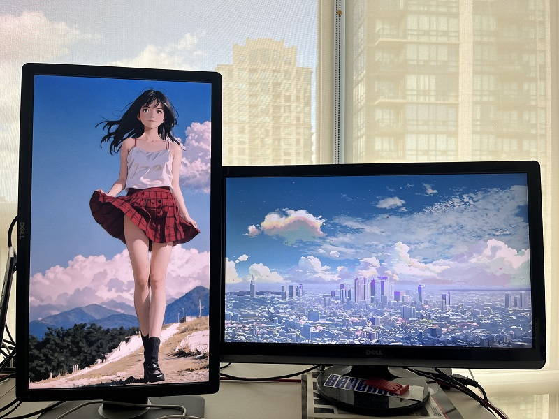
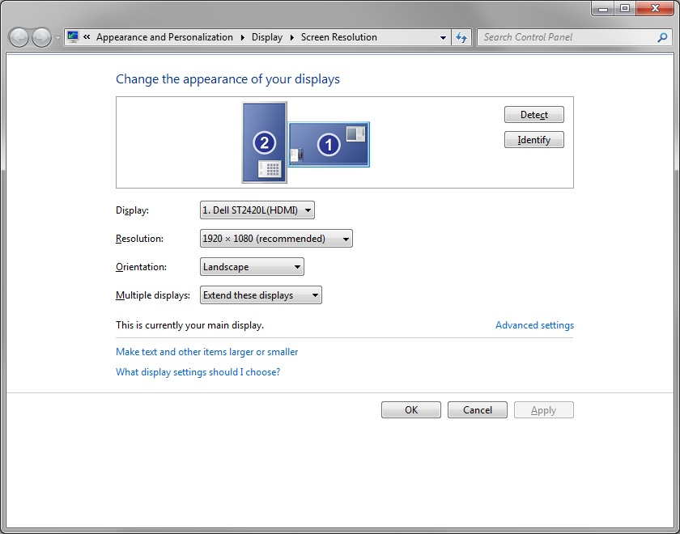
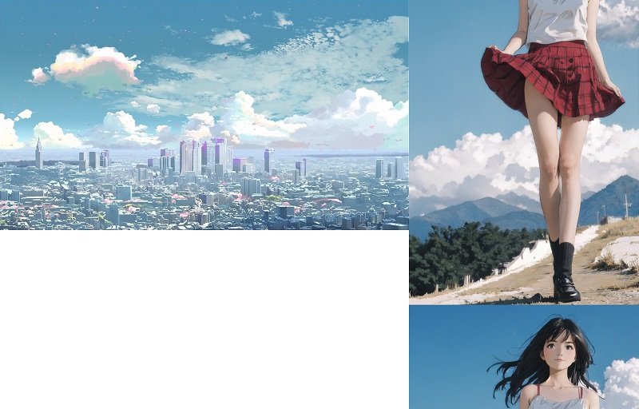

# Different Wallpaper Settings for Horizontal and Vertical Dual Screens under Win7

> This article refers to and draws on the tutorials on Baidu Jingyan: [Link (Simplified Chinese)](https://jingyan.baidu.com/article/76a7e409e5d575fc3b6e15fc.html)  
> However, the original registry-based approach has several pitfalls (such as manual hexadecimal conversion and broken registry GUIDs when changing display cables or ports). This updated version eliminates registry lookups completely by querying the Windows Display API (`user32.EnumDisplayMonitors`) directly.

This code is tested under Windows 7 and Python 3.8.10.  

English | [中文](https://github.com/fyqc/dswfw7/blob/main/README-zh.md)

---

## Features

This script automates generating a single stitched wallpaper for dual-monitor setups with mixed orientations (one horizontal + one vertical) under Windows 7.

The final effect is as follows:  



---

### Why is this needed?

On Windows versions prior to Windows 8, setting separate wallpapers for two monitors with different orientations is notoriously difficult—especially when their top or bottom edges are not aligned at the same height:



When you choose **"Tile" (平铺)** as the picture position in Windows 7, the system anchors the top-left corner `(0, 0)` of the image to your **primary monitor** and wraps any negative or overflowing coordinates around the canvas boundaries:



---

## Preparation

1. Place two prepared images inside your target directory (`dual_monitor_folder`):
   * `vertical_image` — for your portrait monitor (e.g., `1080 × 1920`).
   * `horizontal_image` — for your landscape monitor (e.g., `1920 × 1080`).
   *(Note: If the image dimensions do not match your current monitor resolutions, the script will automatically resize them using Lanczos resampling.)*
2. Install [`Pillow`](https://pypi.org/project/Pillow/) if you haven't already:
   ```bash
   pip install Pillow

---

## Code and Explanations
### 1. Import Libraries & Set File Paths
Instead of `winreg` (whose `UnitedVideo` GUID paths break whenever you swap display cables or update GPU drivers), we use Python's built-in `ctypes` library to query the active monitor layout directly from Windows `user32.dll`.

```python
import ctypes
from ctypes import wintypes
import os
from PIL import Image

dual_monitor_folder = r"D:\Wallpaper"
vertical_image = "132.png"  # 1080*1920
horizontal_image = "wallhaven-3988e6.png"  # 1920*1080
output = "github.png"

os.chdir(dual_monitor_folder)
```

### 2. Query Real-Time Monitor Coordinates via Windows API
`EnumDisplayMonitors` retrieves the exact virtual desktop bounding box (`left`, `top`, `right`, `bottom`) of every connected display in pixels—regardless of whether the vertical monitor is placed on the left or right, or which monitor is set as the primary display.

```Python
class RECT(ctypes.Structure):
    _fields_ = [
        ("left", wintypes.LONG),
        ("top", wintypes.LONG),
        ("right", wintypes.LONG),
        ("bottom", wintypes.LONG),
    ]


monitors = []
MonitorEnumProc = ctypes.WINFUNCTYPE(
    wintypes.BOOL,
    wintypes.HMONITOR,
    wintypes.HDC,
    ctypes.POINTER(RECT),
    wintypes.LPARAM,
)


def _callback(hMonitor, hdcMonitor, lprcMonitor, dwData):
    r = lprcMonitor.contents
    monitors.append({
        "left": r.left,
        "top": r.top,
        "right": r.right,
        "bottom": r.bottom,
        "width": r.right - r.left,
        "height": r.bottom - r.top,
    })
    return True


ctypes.windll.user32.EnumDisplayMonitors(
    None, None, MonitorEnumProc(_callback), 0
)

# Identify the vertical (portrait) and horizontal (landscape) monitors automatically
ver_mon = [m for m in monitors if m["height"] > m["width"]][0]
hor_mon = [m for m in monitors if m["width"] >= m["height"]][0]
```

### 3. Create the Bounding Canvas & Load Images
Calculate the total bounding rectangle across all monitors and load both wallpapers, resizing them if necessary to match each monitor's exact resolution.

```Python
total_w = max(m["right"] for m in monitors) - min(m["left"] for m in monitors)
total_h = max(m["bottom"] for m in monitors) - min(m["top"] for m in monitors)
final = Image.new("RGB", (total_w, total_h), "#ffffff")

hi = Image.open(horizontal_image)
vi = Image.open(vertical_image)

if hi.size != (hor_mon["width"], hor_mon["height"]):
    hi = hi.resize((hor_mon["width"], hor_mon["height"]), Image.LANCZOS)
if vi.size != (ver_mon["width"], ver_mon["height"]):
    vi = vi.resize((ver_mon["width"], ver_mon["height"]), Image.LANCZOS)
```

### 4. Wrap-Around Tiling & Export
In Windows Tile mode, coordinates outside `[0, total_w)` or `[0, total_h)` wrap around via modulo arithmetic (`start_x % cw`, `start_y % ch`). The `paste_tiled()` helper splits any overhanging image into up to 4 quadrants and places them cleanly onto the canvas—replacing manual two's-complement registry math and hard-coded crop offsets:

```Python
def paste_tiled(canvas, img, start_x, start_y):
    """Wrap and paste an image across canvas boundaries to match Windows 'Tile' mode."""
    cw, ch = canvas.size
    iw, ih = img.size
    x0 = start_x % cw
    y0 = start_y % ch

    w1 = min(iw, cw - x0)
    h1 = min(ih, ch - y0)
    w2 = iw - w1
    h2 = ih - h1

    # Primary quadrant
    canvas.paste(img.crop((0, 0, w1, h1)), (x0, y0))
    # Horizontal wrap
    if w2 > 0:
        canvas.paste(img.crop((w1, 0, iw, h1)), (0, y0))
    # Vertical wrap
    if h2 > 0:
        canvas.paste(img.crop((0, h1, w1, ih)), (x0, 0))
    # Diagonal wrap
    if w2 > 0 and h2 > 0:
        canvas.paste(img.crop((w1, h1, iw, ih)), (0, 0))


paste_tiled(final, hi, hor_mon["left"], hor_mon["top"])
paste_tiled(final, vi, ver_mon["left"], ver_mon["top"])

final.save(output)
print(f"Successfully generated {total_w}x{total_h} wallpaper -> {output}")
```

## How to Apply
Run the script to generate `github.png`.

Right-click your desktop -> Personalize -> Desktop Background.

Browse and select the generated `github.png`.

Set Picture position to Tile (平铺) and click Save changes.
